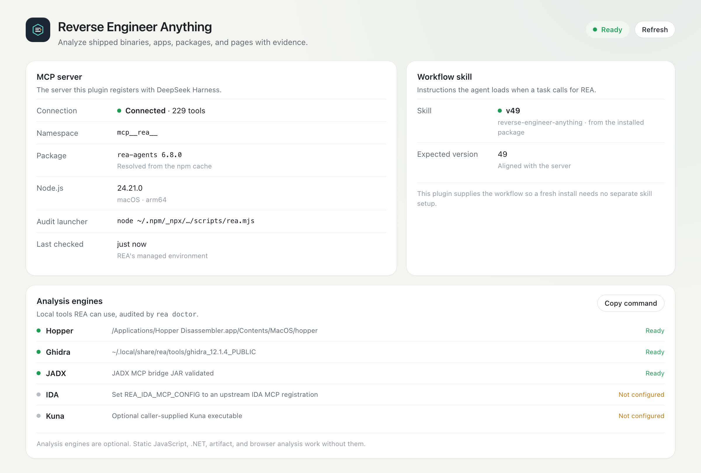
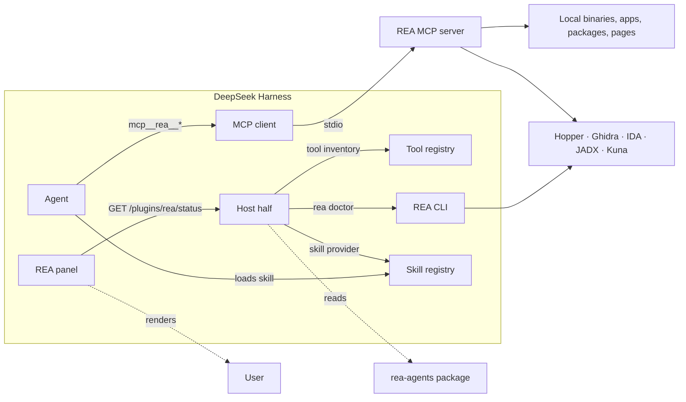
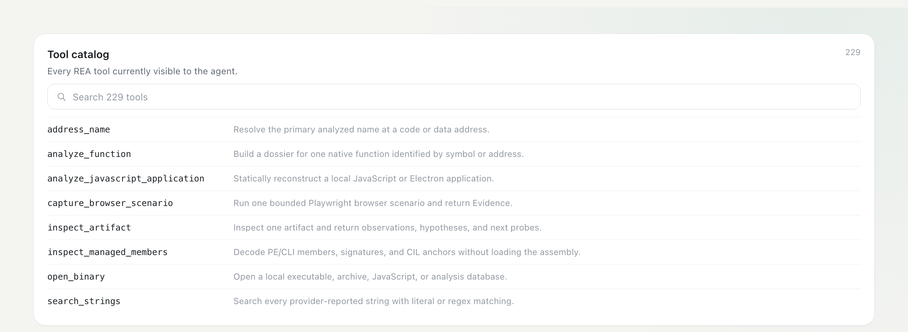

<p align="center">
  
</p>

<h1 align="center">REA for DeepSeek Harness</h1>

<p align="center">
  <strong>Reverse Engineer Anything, inside DeepSeek Harness.</strong><br />
  One installable plugin: REA's MCP server, its workflow skill, and a live readiness panel in the left sidebar.
</p>

<p align="center">
  <a href="https://github.com/axyatech/rea-harness-plugin/actions/workflows/ci.yml"></a>
  
  
  
  
  
</p>

<p align="center">
  
</p>

<p align="center"><sub>Panel preview: connection, workflow version, engine audit, and tool counts at a glance.</sub></p>

---

REA gives an agent tools to inspect binaries, applications, packages, and pages and to return the evidence behind each conclusion. This plugin makes that experience installable from the Harness itself:

- **No hand-written MCP configuration.** A bundle row starts REA's MCP server.
- **No separate skill setup.** The plugin contributes `reverse-engineer-anything` to the agent's skill catalog.
- **No launcher paths to maintain.** The pinned REA package is fetched through `npx` and cached.
- **A visible control surface.** The sidebar panel reports the live tool count, workflow version, engine readiness, and a searchable tool catalog.

## Contents

- [Install](#install)
- [Quick start](#quick-start)
- [What you get](#what-you-get)
- [Architecture](#architecture)
- [Tool catalog](#tool-catalog)
- [Compatibility](#compatibility)
- [Configuration](#configuration)
- [Security and privacy](#security-and-privacy)
- [Troubleshooting](#troubleshooting)
- [Development](#development)
- [Distribution and catalog](#distribution-and-catalog)
- [Roadmap](#roadmap)
- [Contributing](#contributing)
- [License and acknowledgments](#license-and-acknowledgments)

## Install

### Option A — Discover (recommended)

Do this once:

1. **Plugins → More** beside *Experimental plugins* → enable **Custom plugin markets**.
2. Open the new **Discover** tab → **Add index source**.
3. Paste this index URL:

```text
https://raw.githubusercontent.com/axyatech/rea-harness-plugin/main/market/index.json
```

REA for DeepSeek Harness then appears as a searchable market entry, with the version, compatibility, and install target read from the index. Select it and install.

> DSH does not ship an official third-party market; Discover lists the indexes you add. This repository publishes its own format-1 index, so no registry account or npm publication is required.

### Option B — Plugins page, Git repository

**Settings → Plugins → Add plugin** → choose the Git repository option → paste:

```text
https://github.com/axyatech/rea-harness-plugin.git
```

### Option C — Agent or `plugin_manager` tool

```text
plugin_manager action=install_bundle target=https://github.com/axyatech/rea-harness-plugin.git
```

### Option D — Clone and link

```bash
git clone https://github.com/axyatech/rea-harness-plugin.git
plugin_manager action=install_bundle target=/absolute/path/to/rea-harness-plugin
```

### After installing

The bundle is applied immediately. Refresh the Harness page once; new sessions pick up the workflow skill. If the MCP server reports zero tools on first open, wait for the `npx` download and press **Refresh**.

The npm package is prepared as **`@axyatech/dsh-plugin-rea`** but is not published yet; Git and Discover installs are fully supported today. See [Distribution](#distribution-and-catalog).

## Quick start

Ask in a new session:

```text
Explain how search works in this shipped app, and show the evidence.
```

```text
Compare two builds of this Electron app and list the behavior that changed.
```

```text
Decompile this .NET method and reconstruct the interface it implements.
```

The REA skill teaches the agent when and how to use the tool set. The panel confirms that the server, skill, and engines are ready before a deep investigation starts.

## What you get

| Component | Behavior |
| --- | --- |
| **MCP server** | `npx -y rea-agents@6.8.0 mcp`; tools are exposed as `mcp__rea__*` (229 tools in 6.8.0). |
| **Workflow skill** | `reverse-engineer-anything`, registered on each agent's own layer so it outranks a stale user copy while project-local skills still win. |
| **Sidebar entry** | A **REA** icon opens the panel: connection, package, skill version, engine audit, tool search, quick prompts, and commands. |
| **Status endpoint** | `GET /plugins/rea/status` returns the live tool inventory plus a cached `rea doctor` audit. |
| **Cross-platform Host half** | Plain ESM with no runtime dependencies; tested by CI on macOS, Linux, and Windows. |

## Architecture



The panel never talks to the REA server directly: it reads the Host route. The Host half is optional-service based, so it stays inert in a Harness without a web server or skill registry. Nothing is written to disk.

## Tool catalog

REA 6.8.0 exposes 229 tools. The panel makes them searchable, and the same list is available to the agent under the `mcp__rea__` namespace.

<p align="center">
  
</p>

A few common entry points:

| Tool | Use it for |
| --- | --- |
| `open_binary` | Open an executable, archive, JavaScript bundle, or analysis database. |
| `analyze_function` | Build a complete function dossier with pseudocode, assembly, calls, and references. |
| `analyze_javascript_application` | Reconstruct an Electron or JavaScript application without executing it. |
| `inspect_managed_members` | Decode .NET metadata, CIL anchors, and signatures without loading the assembly. |
| `inspect_artifact` | Inventory a package, APK, IPA, DMG, ASAR, or archive with hashes and next probes. |
| `capture_browser_scenario` | Run one bounded browser scenario and return evidence. |

## Compatibility

| Surface | Supported | Status |
| --- | --- | --- |
| **DSH** | `0.2.x` (`engines.dsh: >=0.2.1-rc.3 <0.3.0-0`) | Runtime-verified on `0.2.1-rc.3` (macOS) |
| **Node.js** | REA 6.8.0 engines: `^22.23.4 \|\| ^24.22.1 \|\| >=26.12.1` | Required for the `npx` MCP launch |
| **macOS** | macOS 12+ | Runtime-verified (arm64, Web GUI) |
| **Linux** | CI-tested Host logic | Full DSH + REA runtime not yet verified; REA needs procps |
| **Windows** | CI-tested Host logic | Full DSH + REA runtime not yet verified |
| **Web GUI** | Harness Web | Verified |
| **Electron `file://` shell** | Not verified | Use the Web GUI |

CI runs the Host test suite on **Ubuntu, macOS, and Windows** with **Node 22, 24, and 26**. The suite exercises the status route, loopback guard, home-path redaction, doctor parsing, and skill provider without requiring DSH or REA.

REA's analysis engines are optional:

- **Hopper** is detected at its standard macOS location.
- **Ghidra** needs `GHIDRA_INSTALL_DIR` and a JDK 21+.
- **IDA**, **JADX**, **apktool**, **ADB**, **WABT**, **TShark**, **Kuna**, and a browser for web scenarios are configured through REA's `REA_*` variables and its [installation guide](https://github.com/morluto/rea/blob/main/docs/installation.md).
- Static JavaScript/Electron, .NET, artifact, SQLite, plist, entitlement, Go/Rust, and WASM analysis work without a native engine.

## Configuration

The bundle's rows can be overridden in your own `cordis.patch.yml` (a profile patch, or the home patch at `~/.dsh/cordis.patch.yml`). A non-insert patch replaces the **whole** `config`, so restate every field you need.

Pin another REA version or add engine paths:

```yaml
- id: mcp-rea
  name: "@deepseek-ai/dsh-mcp-client"
  config:
    serverName: rea
    transport: stdio
    command: npx
    args: ["-y", "rea-agents@6.8.0", "mcp"]
    toolCallTimeoutMs: 600000
    failOnStartupError: false
    env:
      GHIDRA_INSTALL_DIR: /absolute/path/to/ghidra_12.1.4_PUBLIC
      JAVA_HOME: /absolute/path/to/jdk-21
```

Keep machine-specific engine paths in that local patch, never in this repository.

Environment variables read by the plugin itself:

| Variable | Purpose |
| --- | --- |
| `REA_ROOT` | Absolute path to a `rea-agents` package to use for the audit and skill. |
| `REA_LAUNCHER` | Absolute path to a `scripts/rea.mjs` launcher. |
| `REA_NODE` | Node executable for the audit (defaults to common paths, then `node`). |
| `REA_NPX` | npm launcher for the audit fallback (defaults to `npx`). |
| `REA_INSTALL_ROOT` | REA's installer state directory (default `~/.local/share/rea`); its `environment.json` supplies engine paths for the audit. |

### Already configured REA by hand?

Two MCP rows with the same `serverName` cannot both load. Remove the older registration first:

- `rea setup --client dsh` writes a `rea-mcp` row to `~/.dsh/cordis.patch.yml` — delete that row.
- A hand-written `mcp-rea` insertion in a profile patch — replace it with the override shown above so it keeps your engine paths and targets the bundle row.

## Security and privacy

- **No secrets, no writes.** The plugin stores nothing and reads only local REA files for status and skill discovery.
- **Loopback-only status.** `/plugins/rea/status` rejects every non-loopback peer with `403`; it answers `GET`/`HEAD` only and uses no request value in a command or path.
- **Home-path redaction.** Every returned path replaces your home directory with `~`, including doctor details and remediation text.
- **No telemetry.** The only network access is npm's first download of the pinned REA package, plus whatever local REA tool you invoke.
- **No remote control.** The plugin opens no port of its own, installs no service, and has no command endpoint.

The full model, including the loopback proxy behavior and supply-chain notes, is in [SECURITY.md](SECURITY.md).

## Troubleshooting

| Symptom | What to do |
| --- | --- |
| Panel shows **Offline** or zero tools | Confirm `node` and `npx` are on the Harness `PATH`; run `npx -y rea-agents@6.8.0 doctor --format json` in a terminal; check the first-download network access; press **Refresh**. |
| `Failed to load plugins` after updating or renaming this bundle | Restart DeepSeek Harness. The browser boot graph caches a client module id across a package rename; a restart rebuilds it. |
| Two `rea` MCP servers or a startup error | Remove the older `rea-mcp`/`mcp-rea` registration from the home or profile patch. |
| Status route returns `403` from another machine | That is the loopback guard. Use an SSH tunnel or a same-machine reverse proxy. |
| Node engine warning in the panel | Update Node to REA's supported range; the server can still run outside it, but the audit reports the mismatch. |
| Skill still shows an older version | New agents resolve the aligned copy; restart Harness so existing sessions re-resolve it. Project-local skills intentionally win. |
| MCP fails only on Windows | Ensure a Node distribution with `npx.cmd` is on `PATH`; the Host half is CI-tested, the DSH MCP launch path is not yet runtime-verified on Windows. |

## Development

No build step. The package is plain ESM plus a browser module.

```bash
npm test        # node --test: route, redaction, loopback, doctor, skill provider
npm run check   # node --check for both halves
npm pack --dry-run
```

CI runs that same sequence on:

- Ubuntu, macOS, and Windows
- Node 22, 24, and 26

The preview images under `docs/assets/` are rendered from the self-contained pages in `docs/preview/`:

```bash
chrome --headless=new --hide-scrollbars --force-device-scale-factor=2 \
  --window-size=1200,810 --screenshot=docs/assets/panel.png \
  file://$PWD/docs/preview/panel.html
```

## Distribution and catalog

DSH's Discover tab has **no official third-party catalog**: it shows only the format-1 indexes a user adds. This repository therefore ships its own index:

```text
market/index.json
```

The index is validated against DSH's `dsh-plugin-market-index` format and pins each release to an immutable Git commit. Adding the raw index URL once makes the plugin discoverable and installable from Discover. The index entry also carries the `engines.dsh` compatibility range, so incompatible Harness versions are marked before installation.

The package is prepared for npm as **`@axyatech/dsh-plugin-rea`** (`private: false`, `publishConfig.access: public`, version `1.1.0`). It is not published yet: the `@axyatech` scope must exist on npm and the publisher must be authenticated. The unscoped `dsh-plugin-rea` name belongs to another publisher and is deliberately not used.

### Publishing a release

One-time setup:

1. Create an npm account, then create the **`axyatech`** organization at
   [npmjs.com/org/create](https://www.npmjs.com/org/create) (free for public
   packages). A scope that does not exist cannot be published to.
2. Authenticate the machine that publishes:

   ```bash
   npm login
   npm whoami
   ```

3. Publish:

   ```bash
   npm publish --access public
   ```

`prepublishOnly` runs the test suite first. The package name, version, license,
repository, and `files` allowlist are already correct.

### Tag-driven publishing

`.github/workflows/release.yml` publishes on a `v*` tag (or a manual dispatch)
using npm **provenance** and the `NPM_TOKEN` repository secret:

```bash
git tag v1.1.0
git push origin v1.1.0
```

Add an npm **automation** token as the `NPM_TOKEN` secret in the GitHub
repository settings. The workflow checks that the tag matches
`package.json`'s version, runs the tests, and publishes with
`--access public --provenance`.

## Roadmap

- [x] Scoped, publish-ready package name
- [x] `engines.dsh` 0.2.x compatibility guard
- [x] Cross-platform test suite and 9-cell CI matrix
- [x] Self-hosted Discover index
- [x] Sanitized panel and tool-catalog previews
- [x] Loopback-only, home-redacted status route
- [ ] npm publication (`@axyatech/dsh-plugin-rea`)
- [ ] Runtime verification on Linux and Windows with DSH
- [ ] Replace the previews with signed live screenshots

## Contributing

Issues and pull requests are welcome. Keep changes focused, run `npm test`, and never commit machine paths, credentials, or verification screenshots that contain personal data. The security model in [SECURITY.md](SECURITY.md) is part of the review surface.

## License and acknowledgments

This plugin is MIT-licensed ([LICENSE](LICENSE)). Its bundled workflow skill is copied from `rea-agents` 6.8.0, also MIT ([LICENSE-REA](LICENSE-REA)); see [NOTICE](NOTICE).

REA is created by [morluto](https://github.com/morluto/rea). Hopper, Ghidra, IDA, JADX, Kuna, and other analysis engines are separate projects with their own licenses and terms.
